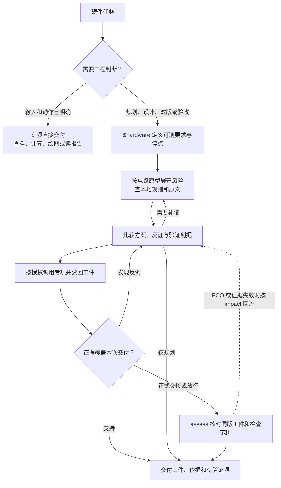

# Hardware Design Skills

面向电子硬件设计、固件与验证的 **48 项可独立调用技能**。`$hardware` 负责规划、设计、深审、ECO、仿真验收、Bring-up 和制造放行。它先由实际电路原型展开风险，读本机依据，再完成工程取舍、实施和验收。查器件、按接线画图和报告转换可直达专项。

[v0.6.0 下载](https://github.com/zhr1008/hardware-design-skills/releases/tag/v0.6.0) · [快速开始](#快速开始) · [使用示例](#在-codex-里怎么用) · [架构图](#架构与分工) · [48 项技能速览](#48-项技能速览) · [模块手册](docs/architecture-guide.md) · [更新日志](CHANGELOG.md)

## 快速开始

### 安装

下载并解压[最新技能包](https://github.com/zhr1008/hardware-design-skills/releases/latest)，或检出仓库。用 Python 3.11 或更新版本在仓库根目录运行。

```powershell
python -X utf8 scripts/install_skills.py --dry-run
python -X utf8 scripts/install_skills.py
```

安装器默认写入 `~/.agents/skills`。用 `--target` 可指定客户端实际读取的目录。预检会列出同名冲突，相同内容会跳过。也可以手动复制 `skills/` 下的平级目录。重新打开技能会话后，用 `$hardware` 或点名具体技能。

### 查看可选后端

技能说明、固定脚本和模板随包提供。EDA、仿真器、固件工具链和仪器按工程配置。下列命令查看包内声明的可选后端及本机可取得的版本证据。CLI 会做版本探测，MCP 连接及调用状态可随已有观测记录查看。[运行依赖](docs/backends.md) · [后端诊断字段](skills/hardware/references/evidence-and-backends.md)

```powershell
python -X utf8 skills/hardware/scripts/backend_doctor.py
```

## 在 Codex 里怎么用

描述你想完成的工程结果，例如设计目标、已有工件、平台以及期望产物。用 `$hardware` 启动工程规划、设计和审查。明确知道实施入口时也可点名专项，例如 [component-sourcing](skills/component-sourcing/SKILL.md) 查料，[pcb-layout-review](skills/pcb-layout-review/SKILL.md) 核布局。

| 可以这样问 | 这次会交付什么 |
| --- | --- |
| 「按这些接口要求独立设计一个模拟前端，给原理图和验算。」 | 可测要求、本机原文、关键方案取舍、按指定格式实现的原理图和验证边界。 |
| 「用 `$hardware` 画一张 RC 低通示意图，给 SVG。」 | Schemdraw 源码和 SVG。需要可编辑的工程原理图时，写明 Altium、EasyEDA Pro 或 KiCad。 |
| 「只读核对这份保存的 Altium 工程，按页列出器件数。」 | 工程成员、保存态的器件明细和无法解析的文件。若还需要未保存的编辑内容，再申请现场读取。 |
| 「审这路 ADC 前端，把需要验证的条件和资料页写出来。」 | 与器件和工况对应的规则、文档版次、物理页或印刷页，以及待计算或待测的项目。 |
| 「优先在我给的标准阻容索引里找料，缺项再查公开来源。」 | 符合规格的候选、缺证据的字段，以及适用的商品页或原厂资料。为工程确认选用时，可从已核对数据生成 AD 选型表。 |
| 「这份 BOM 只转档案 CSV，已有料号原样保留。」 | 按指定模板生成 CSV，读回核对列、位号、数量和料号。 |
| 「看这份 KiCad DRC JSON，把未连接项、禁用规则和覆盖缺口列出来。」 | 已有报告的只读汇总，附报告来源、版本和 SHA-256。 |
| 「投板前核对这版 BOM 和贴装坐标，TP1 不贴。」 | 缺贴、多贴、重复位号和坐标字段问题，以及两份输入的 SHA-256。 |
| 「先识别这个嵌入式工程的工具链，给出构建和 J-Link 烧录的步骤预览。」 | 工具链、目标配置、拟执行步骤与缺项。实际构建、烧录和复位由对应专项按授权执行。 |
| 「核对这份外壳 STEP 的尺寸和工艺要求，先准备 Fictiv 报价用的资料。」 | 本地文件预检和已知的材料、工艺、数量及公差。供应商的 DFM 反馈需要按授权上传后取得。 |
| 「用这份限值判定台架结果，标出超限、缺项和单位错误。」 | 对照板号、硬件版次、固件哈希和单位的逐项核对结果。 |

单项任务交付所问结果即结束。整板任务才需要把接口、版本和验证结果交给后续专项。

## 架构与分工

### 工程任务如何推进



日常设计用轻量 `design_flow.py start <mode> --intent …`，直接取得按原型展开的风险检查和阅读链；例如 ADC 前端从运放与滤波追到转换器，再补供电和回流证据。正式评审、跨阶段交接、正式 ECO 和制造放行使用 `case.json`、`impact` 和 `assess`。项目签核与 L0–L3 操作授权按原渠道处理。 [工程知识地图](skills/hardware/references/knowledge-map.md) · [详细流程与离线命令](skills/hardware/references/design-workflow.md)

### 实施工具与专项分布


- `$hardware` 负责工程决策、证据与验收，按平台及权限调用实施入口。
- `hardware-solution` 协调整板的供电、引脚、通信、机械和固件接口。
- `manage-pcba-program` 管理 PCBA 阶段、工件版本与重验范围，阶段状态为 `PASS`、`BLOCKED` 或 `USER_REVIEW`。
- `hardware-design-review` 汇总工程证据，给出 `Go`、`Hold` 或 `No-Go`，附判定范围与待核项。

公开技能包随附 **98 条可查询规则**、来源书目、知识地图、脚本和合成夹具。用户自有资料可在本机接入，按原件版次和物理页回读。 [工程资料用法](skills/hardware/references/engineering-knowledge.md)

### 各模块怎么配合

| 模块 | 接收什么，交付什么 |
| --- | --- |
| [工程流程与权限](docs/architecture-guide.md#任务路由与权限) | 先定需求、查依据、作决策。实施时按工件和实际动作选择工具，按请求终点验收。 |
| [需求与整板协调](docs/architecture-guide.md#需求与整板协调) | 把目标和参考工程转成可测要求与接口约束，交电路、PCB、固件和测试。 |
| [工程知识与综合评审](docs/architecture-guide.md#工程知识与综合评审) | 查适用规则和资料页，按 [关键工况](skills/hardware/references/engineering-verification.md) 收集证据，给出通过、待验证或阻塞项。 |
| [器件选型与 BOM](docs/architecture-guide.md#器件选型与-bom) | 用规格、订购 MPN 和渠道编号核对器件。把原厂脚位、封装和资格结果交给库、BOM 或制造。 |
| [原理图、工程库与 PCB](docs/architecture-guide.md#原理图工程库与-pcb) | 按 Altium、EasyEDA Pro 或 KiCad 选择入口。交付可编辑工件，或给现有工件的只读检查结果。 |
| [电路仿真](docs/architecture-guide.md#电路仿真) | 对指定模型、输入和工况运行求解，给波形及量测。结果回到电路设计或评审。 |
| [机械与装配](docs/architecture-guide.md#机械与装配) | 用板框、孔位和结构约束做板壳匹配，交 CAD 和尺寸证据，回传 PCB 修改项。 |
| [固件与台架](docs/architecture-guide.md#固件与台架) | 接口约定进入固件构建，镜像绑定板号和测量结果。故障回到电路、固件或配置的源头排查。 |
| [制造包与供应商](docs/architecture-guide.md#制造包与供应商) | 冻结同版 Gerber、钻孔、BOM、CPL 及清单。按具体授权处理外部预览、报价和订单。 |

模块图给出每一步的输入、分支和交接点。按具体技能查职责时，可以直接打开 [48 项技能索引](docs/skill-catalog.md)。图标来自 [Lucide](https://lucide.dev/)。

### 以一块传感器采集板为例

1. **需求与接口**。确定采集范围、误差预算、供电和通信接口，记录各项验收条件。
2. **选料与电路**。从原厂资料核对 MPN、封装、脚位和采样工况，交付原理图、关键网约束及所需的仿真结果。
3. **PCB、机械与固件并行**。共用同一版板级接口约定，同步板框、孔位和连接器装配空间。
4. **首板联调**。用板号、硬件版次和固件哈希绑定日志与测量。异常先区分供电、模拟前端、采样配置和测量条件，再由对应专项在同一工况下复验。
5. **制造冻结**。绑定同版 PCB、BOM、CPL、CAM 读回与装配证据。贴装预览方向有误时，沿库件、板上放置和 CPL 导出追查，修正源头后重新核对受影响的工件。

## 48 项技能速览

下表按工程阶段分成 10 个模块，每项技能均可单独调用。点击技能名直达使用说明，输入要求与上下游交接见[完整技能目录](docs/skill-catalog.md)。

### 路由、需求与项目协作

| 技能 | 核心职责 |
| --- | --- |
| [`hardware`](skills/hardware/SKILL.md) | 主持需求、知识取证、工程取舍、专项执行与验收，按许可采用工具。 |
| [`plan-electronic-product`](skills/plan-electronic-product/SKILL.md) | 将产品想法和使用约束转成可验证的工程需求，交付 `product-brief.yaml` 与 `architecture.md`。 |
| [`hardware-project-library`](skills/hardware-project-library/SKILL.md) | 查找并评估可复用的参考工程，记录来源、版本、验证状态和适用范围。 |
| [`hardware-solution`](skills/hardware-solution/SKILL.md) | 统筹整板设计和改版，保持电路、PCB、机械和固件的供电、引脚与时序约定一致。 |
| [`manage-pcba-program`](skills/manage-pcba-program/SKILL.md) | 在 `.pcba-workflow/` 跟踪 PCBA 各阶段的证据、放行状态以及变更后需要重验的项目。 |

### 电路图、电气设计与综合审查

| 技能 | 核心职责 |
| --- | --- |
| [`draw-schemdraw-circuit`](skills/draw-schemdraw-circuit/SKILL.md) | 用 Schemdraw 将已明确的电路拓扑画成示意图，交付 Python 源码及 SVG 或 PNG。 |
| [`design-and-review-circuit`](skills/design-and-review-circuit/SKILL.md) | 按原理图、网表和工况做电气设计与专项审查，按需用计算或 SPICE 验证并在授权范围内修正。 |
| [`schematic-analyzer`](skills/schematic-analyzer/SKILL.md) | 从 KiCad 工程或 OrCAD Capture XML 与 Allegro 网表中提取器件、网络、总线、层级和电源树。 |
| [`schematic-humanizer`](skills/schematic-humanizer/SKILL.md) | 按功能重排原生原理图，并用视觉检查和重排前后的脚网对比验证结果。 |
| [`hardware-design-review`](skills/hardware-design-review/SKILL.md) | 汇总同版电路、PCB、BOM、固件与测试证据，给出冻结判定（`Go / Hold / No-Go`）或定位板级故障。 |

### 原生 EDA、元件库与 PCB

| 技能 | 核心职责 |
| --- | --- |
| [`altium-library`](skills/altium-library/SKILL.md) | 制作和核验 Altium `.SchLib` 与 `.PcbLib`，对照原厂资料检查引脚、焊盘及机械尺寸。 |
| [`altium-schematic-review`](skills/altium-schematic-review/SKILL.md) | 优先从保存的 `.PrjPcb` 与 `.SchDoc` 核对工程成员、引脚与网络、封装引用和器件适用性。 |
| [`altium-pcb-review`](skills/altium-pcb-review/SKILL.md) | 只读审查 Altium `.PcbDoc` 的连通性、规则和可制造性，将发现定位到层、网络、器件或规则。 |
| [`easyeda-agent`](skills/easyeda-agent/SKILL.md) | 通过嘉立创 EDA 专业版兼容 CLI 和连接器执行获准的原理图或 PCB 编辑，并读回保存结果及适用的 DRC 证据。 |
| [`autodesign`](skills/autodesign/SKILL.md) | 在授权范围内协调目标 EDA 的多步设计会话，并检查实际保存的工程结果。 |
| [`pcb-layout-review`](skills/pcb-layout-review/SKILL.md) | 审查、收尾、迁移或实现 PCB 布局布线，交付原生板或问题清单及连通、几何和规则证据。 |

### 器件选型、Datasheet 与 BOM

| 技能 | 核心职责 |
| --- | --- |
| [`component-sourcing`](skills/component-sourcing/SKILL.md) | 查具体料号、筛选标准阻容或核对库存与价格，形成实际选型清单时默认交付可逐格复制的 AD HTML 表，Excel 按需生成。 |
| [`ee-datasheet-master`](skills/ee-datasheet-master/SKILL.md) | 从原厂 PDF 核实参数和引脚，逐字段标注完整 MPN、封装、文档版次、页码和工况。 |
| [`bom-material-archive`](skills/bom-material-archive/SKILL.md) | 将 CSV 或 Excel BOM 转成物料档案 CSV，并读回核对位号、数量、层级和料号。 |
| [`qualify-pcba-sourcing`](skills/qualify-pcba-sourcing/SKILL.md) | 逐位号核实原选料和替代料的规格、封装、引脚及装配适用性，交付资格结论和 `sourcing-lock.csv`。 |

### 机械、制造包与供应商

| 技能 | 核心职责 |
| --- | --- |
| [`lab-hardware-cad`](skills/lab-hardware-cad/SKILL.md) | 参数化设计夹具、支架和实验硬件，交付 CAD 源码、适用的 STEP/STL/DXF 工件及装配约束。 |
| [`release-pcba-fabrication`](skills/release-pcba-fabrication/SKILL.md) | 整理同版 Gerber、钻孔、BOM/CPL 和图纸，生成 SHA-256 清单并核对 CAM 读回与装配证据。 |
| [`operate-jlcpcb-order`](skills/operate-jlcpcb-order/SKILL.md) | 核对嘉立创 PCB/PCBA 的报价、钢网选项与贴装位置和方向，并按授权推进订单。 |
| [`fictiv`](skills/fictiv/SKILL.md) | 对机械件做本地预检，再按授权处理 Fictiv 的 DFM 反馈、报价或订单。 |

### 固件设计与工具链路由

| 技能 | 核心职责 |
| --- | --- |
| [`embedded-firmware-design`](skills/embedded-firmware-design/SKILL.md) | 对照板级原理图、芯片资料和时序约定，实现或修正 MCU 驱动、BSP 与状态机。 |
| [`embed-ai-tool`](skills/embed-ai-tool/SKILL.md) | 根据工程配置、SDK 和目标板，定位可用的构建、烧录、调试或采集入口。 |
| [`workflow`](skills/workflow/SKILL.md) | 为构建、烧录、监控和调试生成离线步骤预览及缺项清单，供各专项按授权执行。 |

### 固件构建

| 技能 | 核心职责 |
| --- | --- |
| [`build-keil`](skills/build-keil/SKILL.md) | 用 Keil µVision 构建 `.uvprojx` 中的指定目标，记录日志和生成的 AXF、HEX 等产物。 |
| [`build-iar`](skills/build-iar/SKILL.md) | 用 IAR Embedded Workbench 构建 `.ewp` 的指定配置，记录日志、链接映射和目标镜像。 |
| [`build-idf`](skills/build-idf/SKILL.md) | 用 ESP-IDF 构建应用、Bootloader 和分区表，并记录烧录地址的来源。 |
| [`build-cmake`](skills/build-cmake/SKILL.md) | 按项目工具链或 Preset 构建指定 CMake 目标，记录实际配置、日志和产物路径。 |
| [`build-makefile`](skills/build-makefile/SKILL.md) | 核对目标和规则后执行 Makefile 构建，记录退出状态、日志与实际产物。 |
| [`build-platformio`](skills/build-platformio/SKILL.md) | 按 `platformio.ini` 的指定环境构建固件，并记录该环境的构建结果和镜像。 |

### 固件烧录

| 技能 | 核心职责 |
| --- | --- |
| [`flash-keil`](skills/flash-keil/SKILL.md) | 核对镜像、下载器和 Flash 算法后按授权写入设备，记录实际写入、校验和复位结果。 |
| [`flash-idf`](skills/flash-idf/SKILL.md) | 按 ESP-IDF 生成的镜像清单和地址烧录已确认的目标板，记录写入和校验证据。 |
| [`flash-openocd`](skills/flash-openocd/SKILL.md) | 按确认的探针与目标配置用 OpenOCD 写入 Flash，记录校验结果和目标结束状态。 |
| [`flash-jlink`](skills/flash-jlink/SKILL.md) | 核对精确 Device、调试接口、速率和镜像后，用 J-Link Commander 写入并校验。 |
| [`flash-platformio`](skills/flash-platformio/SKILL.md) | 用指定环境的 PlatformIO 上传器写入固件，记录上传结果和实际执行的校验或复位。 |

### 固件与实时故障调试

| 技能 | 核心职责 |
| --- | --- |
| [`debug-gdb-openocd`](skills/debug-gdb-openocd/SKILL.md) | 用同版 ELF 配合 GDB 和 OpenOCD 提取调用栈、寄存器与故障线索。 |
| [`debug-jlink`](skills/debug-jlink/SKILL.md) | 通过 J-Link GDB Server 观测目标运行态，记录获准的调试动作和状态变化。 |
| [`debug-platformio`](skills/debug-platformio/SKILL.md) | 复用项目的 PlatformIO 调试配置，从故障寄存器和调用栈定位源码。 |
| [`rtos-debug`](skills/rtos-debug/SKILL.md) | 结合同版 ELF、RTOS 配置和时序日志，定位任务阻塞、栈溢出、资源竞争或看门狗复位。 |

### 台架、通信协议与测量

| 技能 | 核心职责 |
| --- | --- |
| [`serial-monitor`](skills/serial-monitor/SKILL.md) | 解读串口启动及通信日志，或在授权范围内按指定端口、波特率与时限采集。 |
| [`serial-shell`](skills/serial-shell/SKILL.md) | 向已确认的设备串口发送获准的 Shell 命令，保留原始输入、输出和结束状态。 |
| [`can-debug`](skills/can-debug/SKILL.md) | 解读 CAN/CAN FD 抓包和 DBC 信号映射，按授权监听或发送指定帧。 |
| [`modbus-debug`](skills/modbus-debug/SKILL.md) | 核对 Modbus RTU/TCP 的功能码、寄存器地址、端序和缩放，按授权执行现场读写。 |
| [`logic-analyzer`](skills/logic-analyzer/SKILL.md) | 用数字通道捕获做协议解码和时序核查，按需用已配置的逻辑分析仪采集。 |
| [`visa-debug`](skills/visa-debug/SKILL.md) | 对照仪器手册读取 SCPI 响应和分析波形，记录采样条件及获准的仪器操作。 |

原生 EDA 按工程格式选择 Altium Designer、嘉立创 EDA 专业版（EasyEDA Pro）或 KiCad。Cadence OrCAD Capture XML 和 Allegro 网表组合可用于只读提取电路结构。具体需要的 CLI、连接器及版本见[运行依赖](docs/backends.md)。

## 工程知识、计算与正式审查

### 按工况找判据

从 11 个工程域进入相应专题。随包的 96 条审查规则按 9 类主题组织，保留原件定位。手册与补充研究索引共有 177 个来源编号，可查 AEC-Q100 Rev J1、Q200 Rev E 等资料的版次、引用点及访问边界。若有自己的全文资料库，可用 `--library` 接入，按文档号、印刷页和 OCR 结果定位到原页。[工程域索引](skills/hardware/references/lifecycle-domain-index.md) · [来源索引](skills/hardware/references/source-index.md) · [自有资料库接入](skills/hardware/references/engineering-knowledge.md)

```powershell
python -X utf8 skills/hardware/scripts/knowledge.py sources AN2867 --limit 3
python -X utf8 skills/hardware/scripts/knowledge.py rules --domain PCB与EMC --summary
```

### 选择可复算的验算模型

| 入口 | 可核对的工程问题 |
| --- | --- |
| `engineering_checks.py evaluate` | 提供 I²C 上拉窗口、分压最坏情况、热态铜损、测量保护带、钢网面积比、零失效置信上限、公差链及二端口 S 参数采样无源性八个模型。[输入参数与算例](skills/hardware/references/model-checks.md) |
| `engineering_checks.py adc-settling` / `pdn-target` | 估算 SAR ADC 一阶建立误差，或按目标阻抗核对 PDN 扫频样本。[工程预算](skills/hardware/references/engineering-budgets.md) |
| `engineering_validation.py` | 支持单项区间限值比较、故障检测覆盖率区间、RS-485 支线筛查、稳态结温及圆孔最小环宽。[工程核验与调用示例](skills/hardware/references/engineering-verification.md) |

例如核对 2 kΩ 上拉时，先用供电、电容、上升时间与器件灌电流算可用阻值窗，再比较实物公差。三个入口共提供 **15 种计算或核验方式**，使用 Python 标准库。退出码 `0` 表示已得到所求计算结果或满足本次核验条件，`1` 表示已证越界，`2` 表示待判或输入无效。保守区间只在部分角点越界时，需查这些角点能否实际达到。

### 读回正式审查证据

在已有 KiCad 报告、制造清单和台架记录的检查命令上加 `--formal`，输出版本化证据外壳。记录包含工件 SHA-256、执行状态、修改结果、验证结论及已查和跳过项。KiCad 报告的零发现仅覆盖该报告所记录的检查范围。[证据字段与后端状态](skills/hardware/references/evidence-and-backends.md)

```powershell
python -X utf8 skills/hardware/scripts/hardware_tool.py kicad-report-check board-drc.json --kind drc --formal
```

从保存态工件重新取证时，可以在隔离输出目录运行 KiCad ERC/DRC，使用 ngspice 执行受控网表并读回命名量测，或使用 Gerbonara 独立读回 Gerber 和 Excellon 的图层几何及孔槽。正式审查保留版次、实际运行条件、结果与缺项。[KiCad 原生检查](skills/pcb-layout-review/references/kicad-native-checks.md) · [SPICE 量测](skills/design-and-review-circuit/references/spice-readback.md) · [CAM 读回](skills/release-pcba-fabrication/references/cam-readback.md)

收到上游的正式结果后，可用 `evidence_adapter.py validate evidence.json --verify-artifacts` 重读本地工件，发现文件缺失或字节变化时回到该专项复核。制造清单的正式读回记录清单本身和已核对的包内工件。器件资料有本地 PDF 时可额外核对定位页是否超出原件页数。[证据交接](skills/hardware/references/evidence-and-backends.md) · [器件事实](skills/ee-datasheet-master/references/component-facts.md)

## 固定离线工具速查

从仓库根目录运行。预检示例中的 `bom.csv` 和输出目录按项目替换。

```powershell
python -X utf8 skills/hardware/scripts/hardware_tool.py list --json
python -X utf8 skills/hardware/scripts/hardware_tool.py --plan bom-archive bom.csv --output out/archive.csv
```

| 子命令 | 权限级别 | 输出 |
| --- | --- | --- |
| `ad-saved` | L0 | 读取保存的 `.PrjPcb`、`.SchDoc` 或 `.PcbDoc`，给工程成员或对象数据。需要 `altium-monkey`。 |
| `bom-archive` | L0 / L2 | 预检 BOM 及映射。指定 `--output` 时生成档案 CSV 并读回。 |
| `selection-export` | L2 | 从已核对 JSON 生成 AD HTML 或按需生成 Excel。补 Excel 可用 `--xlsx-only`。 |
| `sourcing-lock-check` | L0 | 核对资格表字段、数量、费用及已记录证据的时效。 |
| `kicad-report-check` | L0 | 读取现有 KiCad 9/10 ERC 或 DRC JSON，列出违规、排除、禁用规则与覆盖范围。支持 `--formal`。 |
| `kicad-native-check` | L2 | 从保存态 KiCad 文件在隔离目录重跑 ERC 或 DRC，保存原生报告、源摘要和覆盖缺项。 |
| `spice-run` | L2 | 在隔离目录用 ngspice 运行已核对的网表和模型，按量测合同保存结果。 |
| `assembly-check` | L0 | 对照同版 BOM 与 CPL，核对位号、DNP、板面、坐标格式和单位。 |
| `release-check` | L0 | 校验冻结制造包清单、版次、尺寸及 SHA-256，并对所列制造 BOM/CPL 重新做装配数据核对。支持 `--formal`。 |
| `bench-check` | L0 | 按输入限值核验台架测量，标出超限、记录无效与缺项。支持 `--formal`。 |

器件专项另有本地阻容筛选、批量查料和按同约束分组的入口。[固定命令用法](skills/hardware/references/local-tools.md) · [器件批查与续跑](skills/component-sourcing/references/batch-lookup.md)

## 权限怎么划分

| 级别 | 典型动作 |
| --- | --- |
| L0 离线读取 | 读保存版工程、库、报告和本地测量数据。 |
| L1 定向只读 | 读已获准的活动文档，或查询公开料价。审查保存态时，转到活动工程需要单独核对许可。 |
| L2 有界本地操作 | 写指定副本、生成本地工件、构建、后台仿真，或不保存设计源的非模态编译。 |
| L3 原工程、前台、设备与外发 | 原工程写入、模态 DRC、桌面操作、烧录、主动发帧、仪器输出、上传、下单和付款。 |

一次调用的等级取其中影响最大的动作。Altium 从离线读取升级到现场桥接，再升级到桌面操作时，分别核对授权。工程和 3D 文件默认留在本机，外发需要针对文件和接收方批准。 [权限细则](skills/hardware/references/permission-gates.md)

## 仓库结构

| 路径 | 内容 |
| --- | --- |
| `skills/` | 48 个平级技能。每个目录从 `SKILL.md` 进入，所需脚本、参考资料及夹具就近存放。 |
| `docs/` | 总图、模块流程图、技能目录及可选运行依赖。 |
| `scripts/` | 离线安装、技能包校验与发布扫描。 |
| `tests/` | 共享离线回归、合成夹具与可选原生工具测试。原理图分析和工程库专项另有自己的测试目录。 |

## 验证与测试

Windows 和 Linux CI 检查技能元数据、相对链接、Python 语法、离线安装、固定工具和可发布内容。项目的原生 EDA、供应商和实体台架结果以实际工程的运行记录为准。

原生测试包含 KiCad 自定义间距规则的正反对照以及 ngspice 的 RC、欠阻尼 RLC 和失败样本。有相应本地后端时，从版本报告和实际测量读回核对。仅安装开发依赖的环境会列出相应跳过原因。

```powershell
python -X utf8 -m pip install -r requirements-dev.txt
python -X utf8 scripts/validate_bundle.py
python -X utf8 scripts/check_publication.py --tree HEAD
python -X utf8 -m pytest -ra tests skills/schematic-analyzer/tests skills/hardware-project-library/tests
```

### 上游原板夹具

原理图专项的层级、查询、缓存和运行时配置测试可使用临时生成的 KiCad 工程。需要核对上游原板的 13 项回归另用 Denali（11 项）和 E1005_v01（2 项）。例如 Denali 要能在 `RK3576.kicad_sch` 的工程层级中读到 U36 的完整料号和 `/FPCIO/FPC_I2C_SCL`。E1005 用例核对层级标签、页名和全部匹配项。官方 Sticky PDF 和 STEP 可协助识别板卡，运行这些用例还需要对应版次的原生 KiCad 工程。[上游固定提交](https://github.com/Seeed-Studio/ai-skills/tree/32a1f21b834bcb08bd273e155d70257dd3d5dbef) · [Sticky 官方硬件资料](https://www.seeedstudio.com/sticky/docs/zh/device-guide/hardware-overview/)

取得两套原工程后，将含子图的完整目录分别放在同一夹具根的 `denali/` 和 `E1005_v01/` 下，让 `kicad-cli` 在 PATH 中可用，然后运行专项。显式指定的夹具路径出错时测试会报错。默认环境缺原板时，pytest 逐项显示跳过原因。

```powershell
$env:SCHEMATIC_ANALYZER_TEST_DATA = (Resolve-Path ./board-fixtures).Path
python -X utf8 -m pytest -ra skills/schematic-analyzer/tests
```

## 许可

自有内容采用 [MIT](LICENSE)。随包第三方文件保留各自版权和许可。 [来源与许可](THIRD_PARTY_NOTICES.md)
