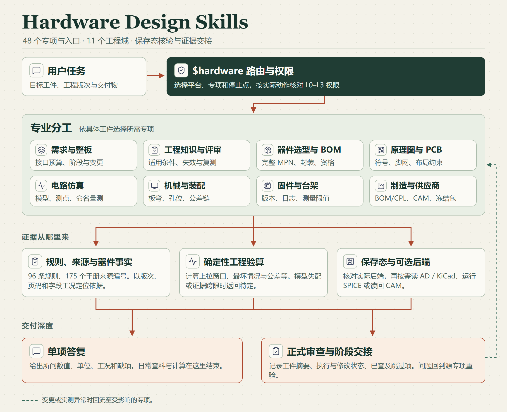

# Hardware Design Skills

**在 Codex 里画电路图、查器件、审查 EDA 工程，或从整板需求推进到制造和台架验证。** 本仓库随包提供 **48 个可单独调用的技能**，包括对应的脚本、模板和参考资料。用 `$hardware` 让助手按任务选择入口，也可以直接调用专项。

[下载最新版](https://github.com/zhr1008/hardware-design-skills/releases/latest) · [架构图](#架构与分工) · [模块关系](#各模块怎么配合) · [安装](#安装) · [48 项技能索引](docs/skill-catalog.md)

## 在 Codex 里怎么用

| 你可以这样问 | 这次任务会交付什么 |
| --- | --- |
| 「用 `$hardware` 画一张 RC 低通示意图，给 SVG。」 | 用 Schemdraw 生成图和 Python 源。需要 EDA 可编辑原理图时，在请求中点明 Altium、EasyEDA Pro 或 KiCad。 |
| 「只读核对这个保存的 Altium 工程，按页列出器件数量。」 | 批查保存版 `.PrjPcb` 的原理图、板卡和文件状态，报告缺失项。若任务需要未保存状态，再核对现场读取的许可。 |
| 「在我提供的本地手册索引里核对数据速率，给原页出处。」 | 对照版次查正文，按需回读 OCR 页，记录物理页和印刷页。 |
| 「审查这路 ADC 前端，先列适用规则和需要验证的条件。」 | 用随包规则查采样建立、回冲、参考源等相关项，结合器件型号和工作条件形成核验依据。 |
| 「给这批 0402 电阻按阻值、精度和功率选料，保留原位号。」 | 先按完整硬条件离线分组，再按组查询。对最终候选核对原厂和渠道证据，工程选型表默认是可逐格复制的 HTML。 |
| 「优先用我这份标准阻容索引找满足规格的料，缺项时再查公开来源。」 | 按明确料号、封装和规格筛本地记录，把字段齐全的匹配与待核实项分开。需要时核对国内商品页及原厂资料。 |
| 「这份 BOM 只转档案 CSV，已有料号原样保留。」 | 按模板映射，在 CSV 读回后结束。 |
| 「读这两份 KiCad 原生 ERC 和 DRC 报告，看看有没有关掉的检查和未连项。」 | 汇总每份报告的错误、警告、排除项、可见的禁用规则及覆盖信息。 |
| 「投板前核对这版 BOM 与贴装坐标，TP1 不贴。」 | 检查缺贴、多贴、重复位号以及坐标、板面和角度字段，记录两份输入的哈希。 |
| 「核对这个冻结制造包，列出缺件和哈希不符的文件。」 | 本地检查版次、清单、尺寸和 SHA-256，返回通过项与缺口。 |
| 「用这份限值核对台架数据，标出超限和缺项。」 | 对照板号、硬件版次、固件哈希和单位，逐项给出限值判定。 |

单项任务从对应入口开始。查一个料号、确认一个字段或出一张说明图，可以在目标产物交付后结束。跨原理图、PCB、固件或制造的任务才需要逐阶段交接。

## 架构与分工



1. **路由和权限。** [`hardware`](skills/hardware/SKILL.md) 根据目标、工件、平台、实际参数和交付要求选择入口。它可独立使用，也可接在宿主的全局路由后。
2. **专项技能。** 各专项定义要核的事实、执行顺序和验收证据。跨模块的设计按需调用几个专项，每个专项承接对应阶段。
3. **运行工具。** 随包脚本处理确定性的离线读取、分组、转换和校验。外部 MCP、EDA、仿真器和设备工具承担实际在线查询、原生操作或现场取证，由使用者按需配置。
4. **工程回读。** 结果记录工件版次、证据来源、实际通过的检查、缺项和授权停点。发现问题时，回到拥有权威源的专项修复，并重验依赖该源的结果。

图标来自 [Lucide](https://lucide.dev/)。平台分流和交接规则见 [硬件路由矩阵](skills/hardware/references/route-matrix.md)。

## 各模块怎么配合

| 模块 | 主要技能与职责 | 输出及下一步 |
| --- | --- | --- |
| **需求、参考工程与整板协调** | [`plan-electronic-product`](skills/plan-electronic-product/SKILL.md) 把目标变成可测要求。[`hardware-project-library`](skills/hardware-project-library/SKILL.md) 盘点参考工程、版本和可复用范围。[`hardware-solution`](skills/hardware-solution/SKILL.md) 在整板项目中协调供电、通信、机械和固件接口。 | 把需求、接口和工况交给电路、PCB、固件与测试。[`manage-pcba-program`](skills/manage-pcba-program/SKILL.md) 按任务记录 PCBA 阶段、工件哈希、放行证据和变更失效。 |
| **器件资料、选型和 BOM** | [`ee-datasheet-master`](skills/ee-datasheet-master/SKILL.md) 查原厂资料。[`component-sourcing`](skills/component-sourcing/SKILL.md) 查精确身份、封装、渠道和候选，按条件分组并复用已有结果。[`qualify-pcba-sourcing`](skills/qualify-pcba-sourcing/SKILL.md) 按位号核对脚位、封装、适用工况和供货风险。 | 把原厂依据、完整订购号和选用证据交给库与 BOM。[`bom-material-archive`](skills/bom-material-archive/SKILL.md) 负责模板转换和 CSV 读回，可单独完成。 |
| **电路、原理图和工程库** | [`draw-schemdraw-circuit`](skills/draw-schemdraw-circuit/SKILL.md) 画说明图。[`design-and-review-circuit`](skills/design-and-review-circuit/SKILL.md) 做电气设计或审查。[`schematic-analyzer`](skills/schematic-analyzer/SKILL.md) 提取支持的连接证据。[`schematic-humanizer`](skills/schematic-humanizer/SKILL.md) 整理阅读顺序并复核脚网。 | 示意图可单独交付。工程任务把原理图、关键网约束和库映射交给板级实现。 |
| **EDA、PCB 和综合评审** | [`altium-library`](skills/altium-library/SKILL.md) 处理库证据，[`altium-schematic-review`](skills/altium-schematic-review/SKILL.md) 和 [`altium-pcb-review`](skills/altium-pcb-review/SKILL.md) 审查对应工件。[`easyeda-agent`](skills/easyeda-agent/SKILL.md) 对接 EasyEDA Pro。[`pcb-layout-review`](skills/pcb-layout-review/SKILL.md) 处理板级布局与布线证据。 | 按实际工件回读保存态、板层、规则、关键网和机械约束。跨电路、BOM、PCB 或实测的放行与问题定位交 [`hardware-design-review`](skills/hardware-design-review/SKILL.md)。 |
| **仿真、机械和板壳配合** | 仿真按任务选 SPICE、Multisim 或指定求解器，将模型、工况与量测绑定到版本。[`lab-hardware-cad`](skills/lab-hardware-cad/SKILL.md) 面向实验夹具和机械接口的参数化 CAD。 | 仿真交波形和量测指标，回到电路专项修正。机械交尺寸和适用的模型或制造文件，板框、开口和安装孔与 PCB 一起复核。 |
| **固件、构建和台架** | [`embedded-firmware-design`](skills/embedded-firmware-design/SKILL.md) 把引脚、电平和时序约束落实到驱动和应用。[`embed-ai-tool`](skills/embed-ai-tool/SKILL.md) 帮助选择工具链。[`workflow`](skills/workflow/SKILL.md) 输出离线步骤预览，各构建、烧录和调试专项执行具体动作。 | 构建交镜像、版本和哈希。台架专项按许可采集串口、CAN、Modbus、逻辑分析仪和 VISA 证据，反馈给电路、固件或综合评审。 |
| **制造包和供应商** | [`release-pcba-fabrication`](skills/release-pcba-fabrication/SKILL.md) 整理和复核本地制包。[`operate-jlcpcb-order`](skills/operate-jlcpcb-order/SKILL.md) 对应 PCB/PCBA 供应商流程。[`fictiv`](skills/fictiv/SKILL.md) 对应机械件的报价和制造。 | 冻结包交验收结果和缺项。按范围分别处理预览、上传、报价、下单与付款。预览发现问题时回到库、板或导出步骤重新核验。 |

[48 项技能索引](docs/skill-catalog.md) 逐项列出了每个技能的入口、用途和交付停点。

### 跨阶段交接的最小证据

| 交给谁 | 随工件交接什么 |
| --- | --- |
| 器件 → 库、原理图、BOM | 完整订购 MPN、原厂资料版次和定位页、脚位到 Pad 的映射、关键工况、封装和渠道料号。 |
| 原理图 → PCB | 同版工程和保存状态、网表或离线证据、适用 ERC 结论、关键网和电气约束、叠层与机械限制。 |
| PCB 接口 → 固件与台架 | 板号和接口版次、引脚与电平、复位和时序约定、SDK 与构建配置、镜像摘要和测量时基。 |
| 冻结板 → 制造包和供应商 | Gerber、钻孔、BOM、CPL、装配资料、工艺和坐标约定、冻结版次及文件哈希。 |

例如，贴装预览显示器件方向不符时，先保留预览证据，再检查封装方向、PCB 放置与 CPL 导出。修正权威源后，把受影响的旧装配结论标为失效，重新导出并核对新版预览。

### 从传感器采集板到可交接的设计

1. **定义输入。** 需求专项明确供电、采集误差、通信接口和板框。整板协调把这些条件写入接口记录。
2. **落实电路。** 器件专项核对候选型号和原厂脚位。电路专项建立连接和关键网约束，机械专项回传孔位及外壳尺寸。确有仿真目标时，把模型和波形用同一电路版次对应起来。
3. **并行交接。** PCB 按网表、叠层和尺寸约束实现。固件按同一份引脚和电平约定构建。台架用板号和镜像摘要绑定波形、总线或启动日志。
4. **按目标结束。** 用户只要设计评审时，交工件和问题清单。要求出包时，依据冻结版生成制造文件和哈希清单。供应商动作再按实际任务和授权范围执行。

## 固定脚本与交付终点

从仓库根目录运行：

```powershell
python -X utf8 skills/hardware/scripts/hardware_tool.py list --json
python -X utf8 skills/hardware/scripts/hardware_tool.py --plan bom-archive bom.csv --output out/archive.csv
```

| 子命令 | 做到哪里 |
| --- | --- |
| `ad-saved` | 结构化读取保存的 `.PrjPcb`、`.SchDoc` 或 `.PcbDoc`，用 `altium-monkey` 解析。 |
| `bom-archive` | 省略 `--output` 时给预检，有输出路径时生成档案 CSV 并读回。 |
| `selection-export` | 按已核对的 JSON 生成 AD HTML，Excel 按需生成。后补 Excel 可用 `--xlsx-only`。 |
| `sourcing-lock-check` | 检查资格表的字段、数量、费用和已记录证据的时效。当前库存与报价由相应渠道工具取得。 |
| `kicad-report-check` | 读取现有 KiCad 9/10 ERC 或 DRC JSON，区分可见违规、排除项、禁用规则和报告覆盖。 |
| `assembly-check` | 对照同版 BOM 与 CPL，核对位号、DNP、板面、坐标格式及单位声明。 |
| `release-check` | 核对本地冻结包版本、清单与哈希，并报告缺失、变化或越界项目。 |
| `bench-check` | 按指定限值校验本地台架测量，并区分超限、身份或单位错误与缺项。 |

器件批查单独提供 `batch_lookup.py`、`plan_selection_groups.py` 和固定出表脚本。根路由按任务选择入口，已有报告可以只补缺项。固件预览可查看计划中已给定和仍需补齐的信息。 [固定命令参数](skills/hardware/references/local-tools.md) · [器件批查与续跑](skills/component-sourcing/references/batch-lookup.md) · [器件与 BOM 分级](skills/component-sourcing/references/selection-depth.md)

已有证据时，可独立运行每一项检查。从设计推进到制造时，先读 ERC/DRC 与工程状态，再核对 BOM/CPL 和独立 CAM 证据，最后校验冻结包。制成样机后，把测量绑到实际板号与固件，再按限值核对。需要原生导出、独立 CAM、虚拟固件回归或现场测试时，再按阶段选择已有外部工具。 [可选工具与接入点](docs/backends.md)

指定本地 OCR 数据目录后，`ocr_books.py` 可按书查看覆盖、查同页词和读回单页。`pack_mineru_book.py` 可将已有 MinerU Middle JSON 转为索引并按原件版本补页。工程资料留在使用者管理的数据目录。 [逐页 OCR 用法](skills/hardware/references/ocr-books.md)

`knowledge.py rules` 查询随包的 96 条审查规则和来源页码，覆盖 PCB/EMC、模拟、电源、采样、接口、标准、无源器件、验证与热设计。带 `--library` 可接入本机全文索引，查资料、搜索章节及读取原页文字。公开包内的规则与书目可直接离线查询。 [规则与证据流程](skills/hardware/references/design-review-basis.md) · [知识库用法](skills/hardware/references/engineering-knowledge.md)

指定本地标准阻容索引后，`query_passive_index.py` 可按 C 号、完整料号或结构化规格筛选。查当前供货、更新证据或核对 CAD 库件时，再走相应入口。 [器件查询与回退](skills/component-sourcing/references/sourcing-queries.md)

## 权限怎么划分

| 级别 | 典型动作 |
| --- | --- |
| **L0 离线读取** | 读保存版工程、库、报告和已有数据。 |
| **L1 定向只读** | 读已授权的活动文档或查公开料价。保存版证据不足、需要转现场时先申请。 |
| **L2 有界本地动作** | 指定副本写入、生成本地工件、构建、后台仿真，以及保护源文件的非模态编译。 |
| **L3 原工程、前台、设备与外发** | 原工程写入、模态 DRC、桌面操作、烧录、主动发帧、仪器输出、文件上传、下单和付款。按具体动作先核授权。 |

等级由实际工具和参数决定。Altium 的离线读、现场桥接和界面操作分别核对权限。模型及工程文件默认在本机处理，需要外发时单独核准接收方和范围。 [权限门禁](skills/hardware/references/permission-gates.md)

## 安装

下载并解压 [最新技能包](https://github.com/zhr1008/hardware-design-skills/releases/latest)，或检出仓库。用 Python 3.11 或更新版本，在仓库根目录运行：

```powershell
python -X utf8 scripts/install_skills.py --dry-run
python -X utf8 scripts/install_skills.py
```

默认目标为 `~/.agents/skills`，用 `--target` 可指定客户端实际读取的技能目录。也可以手动复制 `skills/` 下的平级技能目录。预检会标出同名冲突并保留已有内容，内容相同的技能会跳过。重新打开技能会话后可用 `$hardware`。

安装包含技能、脚本和模板。Schemdraw、Altium 文件解析器、商用 EDA、仿真软件、连接器和设备运行环境按实际任务配置。仓库内的 `component-sourcing` 是随包技能，目录查询和供应商接口由独立的 Component Sourcing MCP 提供。 [运行依赖](docs/backends.md) · [Component Sourcing MCP](https://github.com/zhr1008/component-sourcing-mcp)

## 验证与许可

仓库的 Windows 和 Linux 检查覆盖技能元数据、相对链接、Python 语法、离线安装、固定 CLI 和发布内容检查。仓库校验的 YAML 依赖仅供开发及 CI 使用。原生 EDA、供应商、终端设备和实际制造按本次运行留存证据。可运行以下命令。

```powershell
python -X utf8 -m pip install -r requirements-dev.txt
python -X utf8 scripts/validate_bundle.py
python -X utf8 scripts/check_publication.py --tree HEAD
python -X utf8 -m unittest discover -s tests
```

自有内容采用 [MIT](LICENSE)。随包第三方文件保留各自版权与许可。 [来源与许可](THIRD_PARTY_NOTICES.md)
