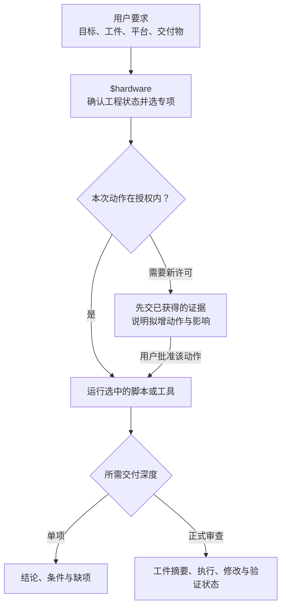
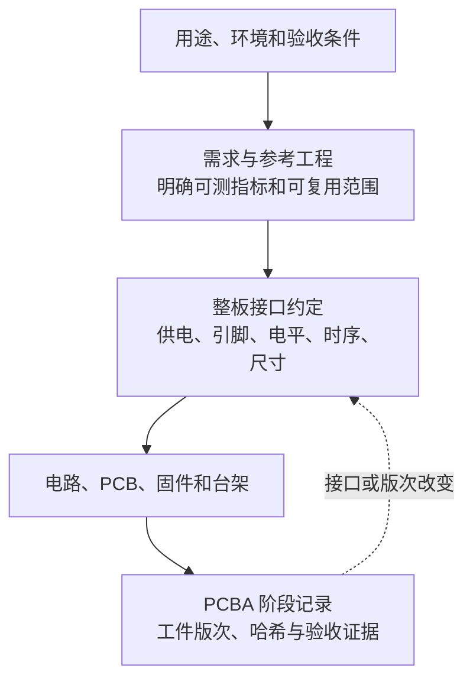
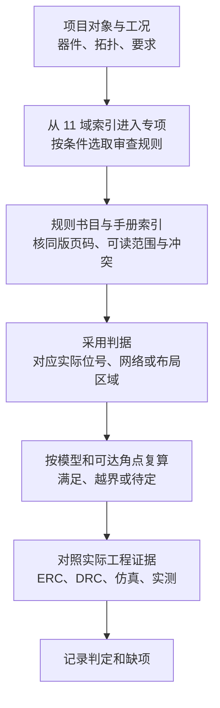
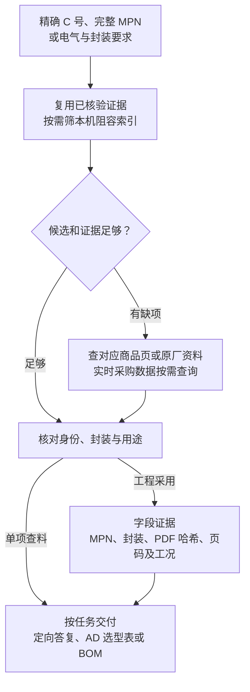
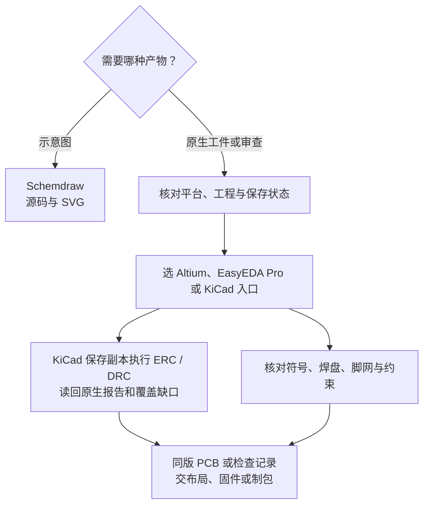
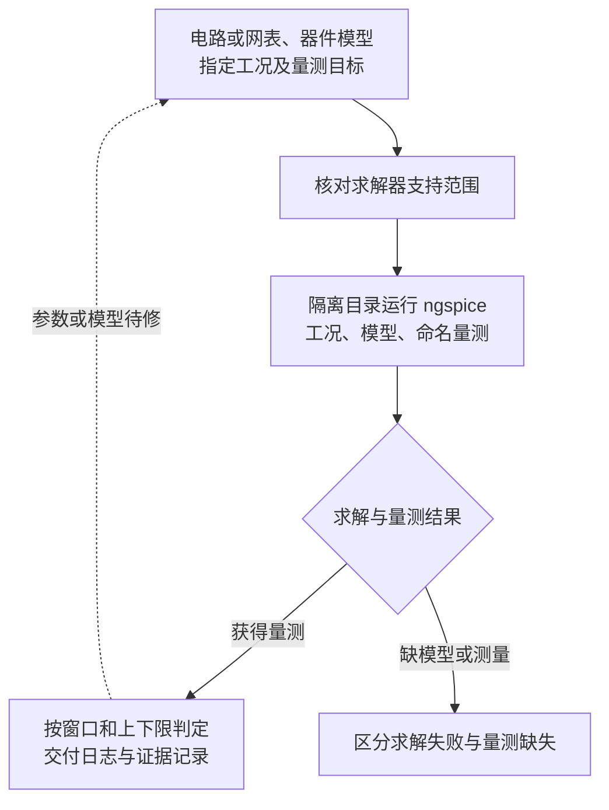
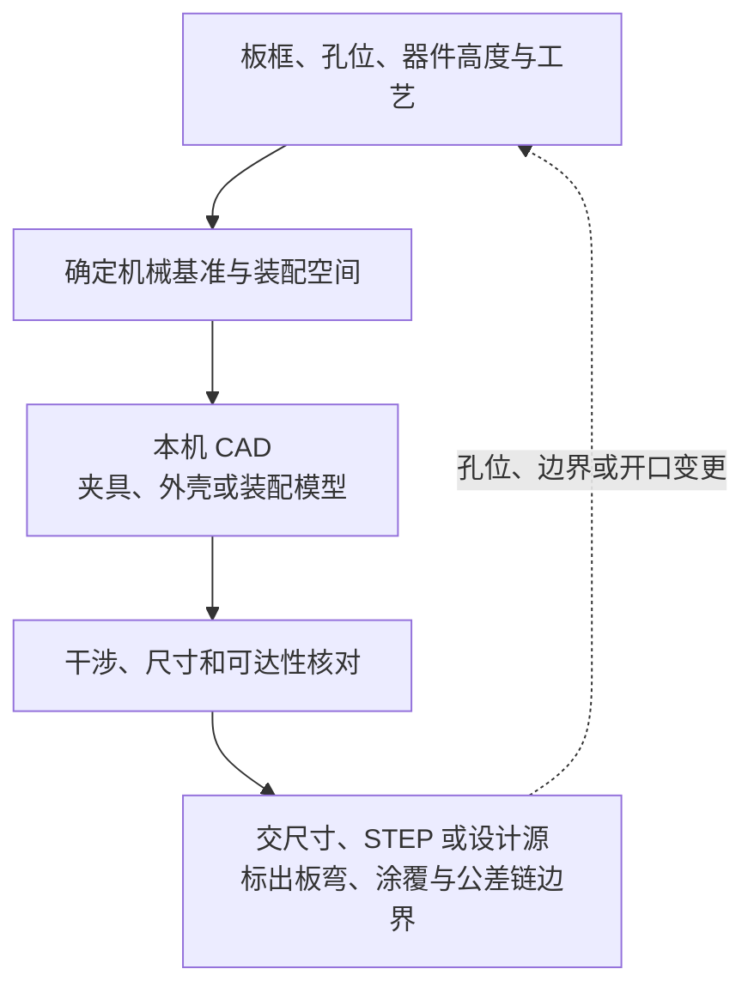
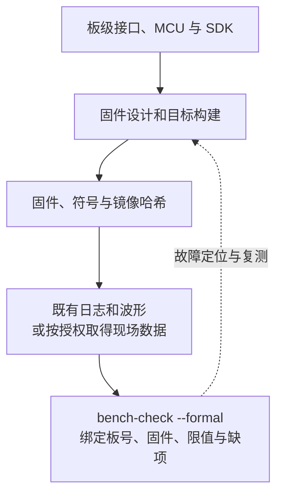
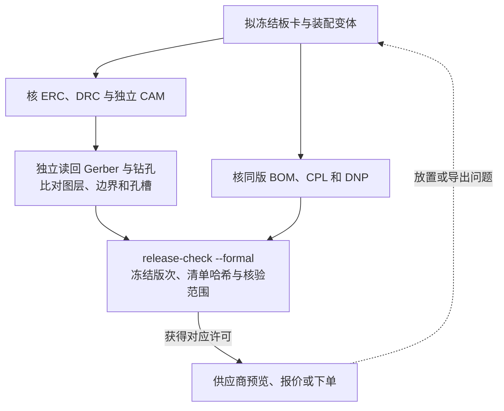

# 硬件技能包模块手册

[总图](../README.md#架构与分工) · [技能索引](skill-catalog.md) · [可选工具](backends.md)

从任务当前所在的环节开始。例如，有一份保存的 PCB 和 DRC 报告时，直接读板和报告即可。跨阶段时，把交付物和能核对它的版本、工况及出处一同交给接手专项。

[路由](#任务路由与权限) · [需求](#需求与整板协调) · [知识库](#工程知识与综合评审) · [选料](#器件选型与-bom) · [EDA](#原理图工程库与-pcb) · [仿真](#电路仿真) · [机械](#机械与装配) · [固件与台架](#固件与台架) · [制包](#制造包与供应商) · [交接证据](#跨模块交接)

## 任务路由与权限

同名技能先核对用户指定的来源和项目约定。然后根据工件和目标选择入口。例如，有保存的 Altium 工程且只要求审查时，先读取离线文件。离线找不到编译后的网络或未保存状态时，说明缺哪项，再申请该工程的只读桥接。用户明确要求查看当前打开的工程时，这个请求已覆盖相应的 L1 定向读取。进一步打开桌面界面、跑模态检查或修改工件时，按实际动作单独核对许可。

脚本用于格式和输入明确的重复工作。现场桥接、供应商接口、EDA 程序和仪器依赖本机配置。需要前台操作或外发时，具体到窗口、工件、命令或接收方。工具读回可能同时出现结果和受限项，分别记入交付。 [权限细则](../skills/hardware/references/permission-gates.md) · [路由矩阵](../skills/hardware/references/route-matrix.md)

## 需求与整板协调

`plan-electronic-product` 明确可测的目标和工况。`hardware-project-library` 盘点已有工件、版次和可用的参考证据。例如，一套参考板可提供连接器尺寸和供电拓扑，实际项目所需的电流、保护和 EMC 条件仍要比较。系统设计由 `hardware-solution` 协调，涉及引脚、复位和电平的决定写进同一份板级接口约定。

`manage-pcba-program` 用工件版次和哈希记录当前阶段、放行状态及未关闭问题。接口变更时，标出原理图、PCB、BOM、固件与测试中哪些旧结论需要复核。综合结论可以交 `hardware-design-review`。 [整板方案](../skills/hardware-solution/SKILL.md) · [PCBA 阶段管理](../skills/manage-pcba-program/SKILL.md)

## 工程知识与综合评审

例如核对 ADC 前端，先按采样速率、信号带宽和驱动拓扑选采样建立、回冲和基准误差等规则。回查适用的原厂手册及来源页，把规则中的条件换成当前电路的器件、负载与测试工况。判断依据要写清文档版次、PDF 物理页和已确认的印刷页。

规则与书目随包提供，`knowledge.py rules` 按工况选规则，`knowledge.py sources` 跨书目检索版次。已有本机全文索引时用 `--library` 接入。扫描件可以通过逐页 OCR 找页，公式、图表及单位以原页核对。综合评审汇集各专项的证据，给出本版可关闭的问题和仍待取证的项目。 [设计审查规则](../skills/hardware/references/design-review-basis.md) · [工程知识库用法](../skills/hardware/references/engineering-knowledge.md)

## 器件选型与 BOM

正式采用器件参数时，`ee-datasheet-master` 将原厂 PDF 的版本、物理页、工况和 min/typ/max 绑定到字段；证据缺失的字段保留 `unknown`。`component-sourcing` 对照完整订购 MPN、渠道 C 号、封装与使用条件。标准阻容索引可先筛候选。同规格的位号可以先分组，按组查询并保留原位号。索引只覆盖已有证据，缺失的规格和实时库存、数量价由对应渠道核实。

查资料或价格可以只答所问字段。确定工程选用时，可用同一份经核对的 JSON 导出 AD HTML，Excel 按需生成。物料档案转换交给 `bom-material-archive`，读回 CSV 后结束。制造前逐位号核资格时，用 `qualify-pcba-sourcing` 交付 `sourcing-lock.csv`，把替代料和封装风险交给电路、库和制造。 [查料与回退](../skills/component-sourcing/references/sourcing-queries.md) · [AD 表交付](../skills/component-sourcing/references/ad-selection-export.md)

## 原理图、工程库与 PCB

画说明电路时用 `draw-schemdraw-circuit`。做可编辑的工程原理图时，由 `design-and-review-circuit` 按选定 EDA 执行。已有工程先核实文件类型、版本和保存状态。保存态的 Altium 原理图、PCB 与库分别走相应离线入口。EasyEDA Pro 对照其专业版工程和适配器。KiCad 有现成 ERC/DRC JSON 时用 `kicad-report-check` 读回，再根据具体任务决定是否需要运行原生检查。

原理图交给 PCB 时带同版工程、关键网和布局约束，器件库证据须能解释引脚到焊盘的映射。布局收尾时比较实际连通、板层、几何和规则证据。需要跨平台迁移时，对照目标原生文件重新核脚网、封装和板级约束。 [EDA 平台分流](../skills/hardware/references/route-matrix.md#按工程平台选执行入口) · [PCB 布局与审查](../skills/pcb-layout-review/SKILL.md)

## 电路仿真

电路专项先给定要回答的问题，例如稳态输出、启动瞬态或温度扫描。仿真按项目选择 SPICE、Multisim 或已配置的求解器。模型版本、网表、输入条件、量测定义和运行日志随输出一起保留。危险副作用按实际入口判断，例如桌面弹窗或改写原文件的工具操作。

仿真输出要对应所依据的版本和工况。工程中需要实测的指标，留给相应台架验证。例如仿真显示跨温度的建立时间风险，可将采样配置、输入阶跃、负载和量测窗口交给台架复测。 [仿真与工具入口](backends.md) · [SPICE 权限](../skills/hardware/references/permission-gates.md#spice-与-solidworks-前台和外发许可)

## 机械与装配

先让板级与机械使用同一原点、单位和版本。需要核对的尺寸包括板边与安装孔、连接器的插拔空间、器件高度和结构公差。`lab-hardware-cad` 可承接实验夹具、支架和机械接口。可用的本机 CAD 依据项目配置选择，发给 PCB 的应是具体尺寸或约束。

板框或安装孔变化时，同步更新电路板上的机械约束和装配检查。交付对应的设计源、尺寸证据和适用的 STEP 等格式。原始 3D 文件和几何数据优先在本机使用，发给外部供应商或服务时按本次动作与接收方申请。 [机械专项](../skills/lab-hardware-cad/SKILL.md) · [CAD 与外发许可](../skills/hardware/references/permission-gates.md#spice-与-solidworks-前台和外发许可)

## 固件与台架

`embedded-firmware-design` 接收 PCB 的引脚、电平、复位、时序和硬件版次，落实到驱动、BSP 或应用。实际构建按项目选 Keil、IAR、ESP-IDF、CMake、Makefile 或 PlatformIO。`workflow` 可预览过程，各构建、烧录和调试专项按授权执行实际步骤。

取得原始日志或波形后，记下板号、硬件版次、固件哈希、采样条件和单位。`bench-check` 对照限值与测量 CSV，区分超限、无效输入和缺项。已有串口、CAN、Modbus、逻辑分析或 VISA 记录可先离线看。需要烧录、主动发帧或驱动仪器输出时，核对具体设备、命令和许可。根据故障证据回到电路或固件源头修正。 [固件专项](../skills/embedded-firmware-design/SKILL.md) · [台架限值核对](../skills/hardware-design-review/references/bench-results.md)

## 制造包与供应商

`release-pcba-fabrication` 收集同版 Gerber、钻孔、BOM、CPL 和装配资料。独立 CAM 核几何与图层，`assembly-check` 核位号、DNP、板面、坐标和单位，之后由 `release-check` 核清单与文件。实际放置还需检查原点、底面变换、旋转和 Pin 1。

给嘉立创或 Fictiv 交接时附冻结版本、文件哈希和用户确认的规格。外部预览、报价、下单和付款分别核对授权。如果预览显示问题，从相应封装、PCB 放置或导出设置修复，更新受影响的结论并重跑检查。 [制造包专项](../skills/release-pcba-fabrication/SKILL.md) · [装配预检](../skills/release-pcba-fabrication/references/assembly-check.md)

## 跨模块交接

| 交接 | 随工件保留的证据 |
| --- | --- |
| 器件交工程库、原理图或 BOM | 完整订购 MPN、渠道料号、原厂资料版次与定位页、脚位到焊盘的映射、关键工况和封装。 |
| 原理图交 PCB | 同版工程的保存态、网表或离线连接证据、适用的 ERC 结论、关键网和电气约束、叠层及机械限制。 |
| PCB 接口交固件与台架 | 板号与版次、引脚与电平、复位及时序、SDK 和构建配置、镜像摘要、测量时基。 |
| 冻结板交制造及供应商 | Gerber、钻孔、BOM、CPL 和装配资料，附工艺、坐标约定、冻结版次及文件哈希。 |

涉及多处原因的故障先交综合评审列假设。再用现有日志和波形，或在授权范围内通过台架、总线和仪器取证。数据分析确定影响范围后，交回电路或固件专项修正，按同一工况复测。 [交接契约与故障回流](../skills/hardware/references/route-matrix.md#跨专项移交与变更回流)
